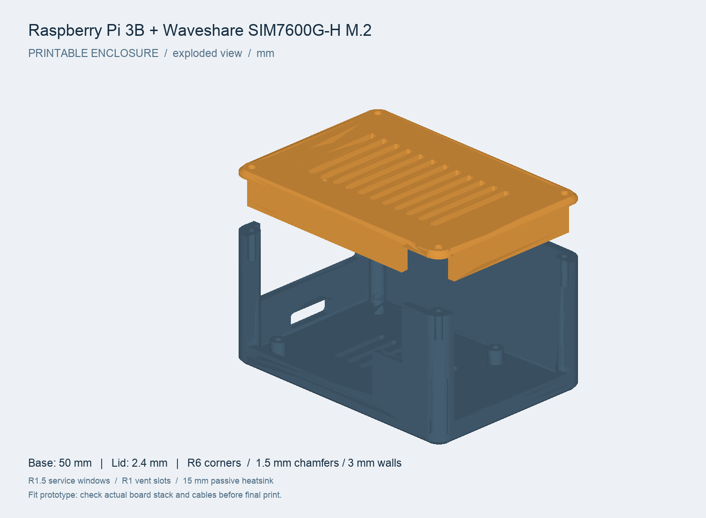
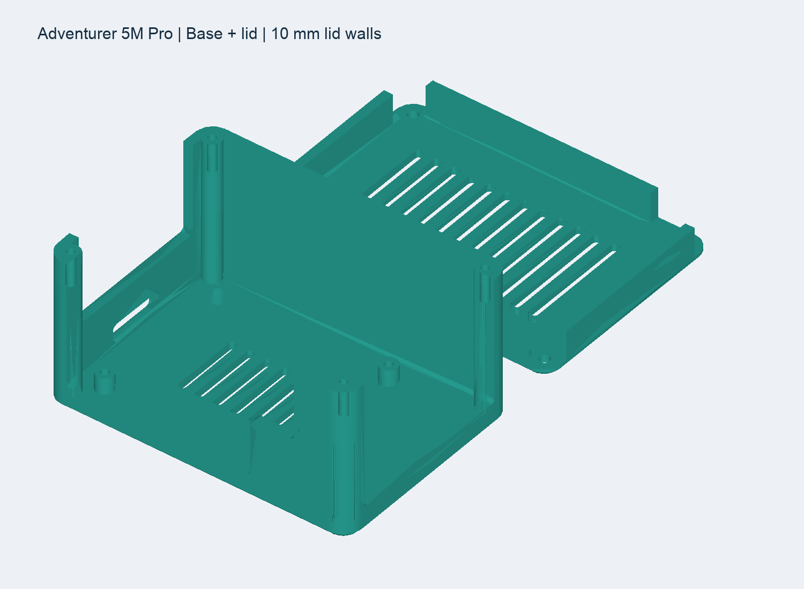
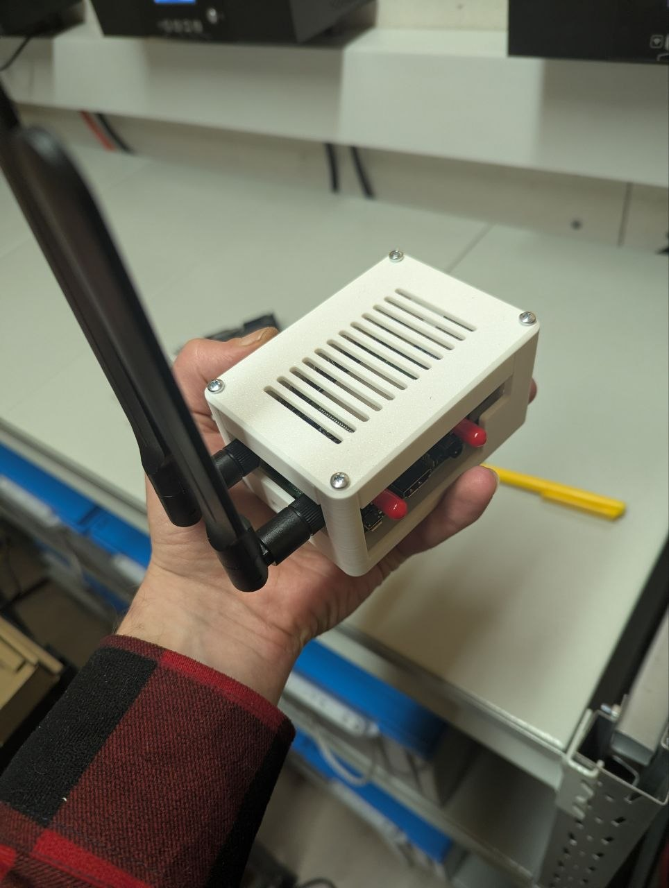
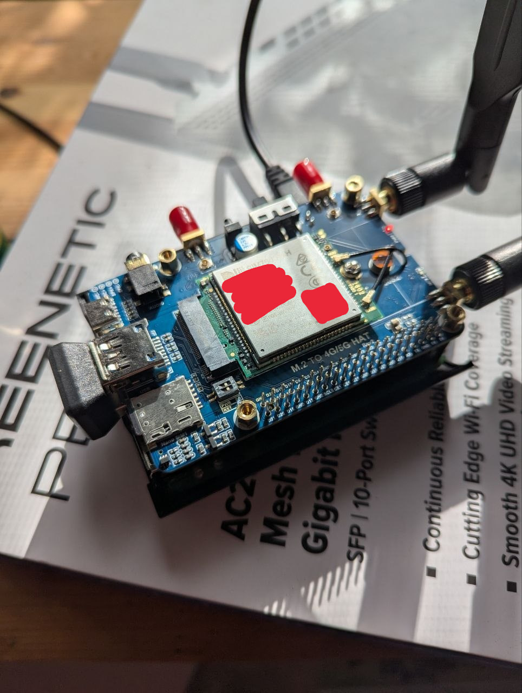

# Caller — голосовые агенты на Raspberry Pi + SIM7600G-H

Сервер для входящих и исходящих звонков, которые обслуживает голосовой агент
**Yandex AI Studio** (Realtime API). Работает на Raspberry Pi 3 с HAT
**Waveshare M.2 → 4G/5G** и модулем **SIM7600G-H**. Включает веб-интерфейс,
REST API и базу SQLite. Запускается как systemd-сервис, без контейнеров.

```
Абонент ⇄ GSM/LTE ⇄ SIM7600 ─┬─ /dev/ttyUSB2  AT-команды (звонки, SMS, статус)
                              └─ /dev/ttyUSB4  PCM 8 кГц (голос)
                                     │ пересэмплирование 8k ⇄ 16k
                                     ▼
                         Caller (Python, FastAPI) ⇄ WebSocket ⇄ Yandex AI Studio Realtime API
                                     │
                          Веб-интерфейс / REST API / SQLite
```

## Возможности

- **Модем**: уровень сигнала (CSQ/RSSI), RSRP / RSRQ / SINR с графиками, оператор, тип сети,
  диапазон, соты, регистрация, IMEI / IMSI / ICCID, температура и питание модуля.
- **Звонки**: исходящий звонок с выбором сценария, агента и значений переменных, без агента
  или **самому через браузер** (микрофон и динамики ноутбука); очередь
  и отложенные звонки; автоответ агентом на входящие; живой транскрипт; DTMF; запись
  разговора в стерео-WAV (слева абонент, справа агент); итог звонка (`save_result`).
- **SMS**: диалоги, отправка (длинные SMS и кириллица через PDU/UCS-2), приём (включая составные).
- **Справочник**: контакты, поиск, импорт из CSV, быстрый звонок или SMS.
- **Сценарии**: промпты с переменными `{{name}}`, первая фраза, агент по умолчанию,
  предпросмотр итоговых инструкций.
- **Голоса**: голоса Yandex SpeechKit (эмоция, скорость) и Fish Audio; у голосов Fish — заготовки хезитаций
  (прослушать, перегенерировать).
- **Агенты**: роль, системный промпт, голос из раздела «Голоса», VAD, пауза конца реплики, лимит длительности,
  функции (`hangup_call`, `save_result`, `send_dtmf`), дополнительный JSON для `session.update`.
- **Настройки**: порты модема, режим сети (CNMP), APN, громкость и усиление, автоответ,
  аудио, ключи Yandex, API-токен, AT-консоль и лог событий модема (URC).

## Корпус для 3D-печати

В папке [rpi3_lte_case](rpi3_lte_case/README_RU.md) — корпус для Raspberry Pi 3 Model B
и Waveshare SIM7600G-H M.2 4G HAT: основание, вентилируемая крышка со стенками
высотой 10 мм, исходники OpenSCAD и генератор STL.
Габарит собранного корпуса — **102 × 72 × 52,4 мм**.

- [Основание STL](rpi3_lte_case/stl/base.stl)
- [Крышка STL](rpi3_lte_case/stl/lid.stl)
- [Печатный стол для Flashforge Adventurer 5M Pro, сопло 0,4 мм](rpi3_lte_case/print_plate_5m_pro.3mf)
- [Размеры, настройки печати, крепёж и сборка](rpi3_lte_case/README_RU.md)

### Виды модели





### Фотографии устройства





## Установка на Raspberry Pi

Рекомендуется **Raspberry Pi OS Lite 64-bit** (Bookworm): без рабочего стола больше
ресурсов остаётся сервису, а для aarch64 есть готовые колёса зависимостей.

1. Подключите HAT к Pi **USB-кабелем** (голос и AT идут через USB) и дайте HAT'у
   собственное питание: USB-порта Pi 3 при передаче по LTE обычно не хватает.
2. Проверьте, что модем виден: `lsusb | grep 1e0e` и `ls /dev/ttyUSB*` (должны быть ttyUSB0–4).
3. Скопируйте проект на Pi и запустите установщик:

```bash
sudo ./deploy/install.sh
```

Установщик создаст пользователя `caller`, скопирует код в `/opt/caller`, создаст venv,
поставит udev-правила (`/dev/sim7600-at`, `/dev/sim7600-audio`), отключит ModemManager и
включит сервис `caller`. Данные (БД и записи) лежат в `/var/lib/caller`.

Откройте `http://<ip-pi>:8080`. Документация API (Swagger): `http://<ip-pi>:8080/docs`.

Для разговора через микрофон ноутбука откройте **`https://<ip-pi>:8443`**: браузеры дают доступ к
микрофону только по HTTPS. Сертификат самоподписанный, он создаётся при первом запуске в
`/var/lib/caller/tls`. Браузер один раз попросит подтвердить исключение.

Управление сервисом:

```bash
sudo systemctl status caller
```

```bash
journalctl -u caller -f
```

Порт и каталог данных задаются в `/etc/default/caller`. Всё остальное настраивается в интерфейсе.

## Подключение Yandex AI Studio

1. Создайте сервисный аккаунт в каталоге Yandex Cloud.
2. Выдайте ему роли `ai.models.user`, `ai.languageModels.user`, `ai.speechkit-stt.user`, `ai.speechkit-tts.user`.
3. Создайте API-ключ с областью `yc.ai.foundationModels.execute`.
4. В интерфейсе: **Настройки → Yandex AI Studio**, укажите folder_id и API-ключ.

Подключение идёт к `wss://ai.api.cloud.yandex.net/v1/realtime?model=gpt://<folder>/speech-realtime-250923`
с заголовком `Authorization: Api-Key …`. Модель, URL и частоту PCM
(**Настройки → Звонки → Аудио**, по умолчанию 16 кГц) можно поменять, если в AI Studio
выйдет новая версия. Если агенту нужны функции AI Studio (например, `file_search`
по базе знаний), добавьте их в поле «Дополнительные параметры session.update» агента.

## Голос Fish Audio (необязательно)

Агент может говорить реалистичным голосом [Fish Audio](https://fish.audio) через посредника Kitta
(fishaudio.org, оплата картой РФ). Yandex Realtime API при этом по-прежнему распознаёт речь, ведёт диалог
и вызывает функции, но отвечает **текстом** (`output_modalities: ["text"]`); каждую фразу ответа озвучивает
Fish (Realtime TTS v3, WebSocket). Звук приходит как WAV (PCM 44,1 кГц) и пересэмплируется в 8 кГц на Python —
на Pi 3 это ~10% одного ядра, внешних декодеров не нужно.

1. Нужен пакет `msgpack` (в `requirements.txt`).
2. **Настройки → Fish Audio** — API-ключ с fishaudio.org.
3. **Голоса** — после сохранения ключа сюда добавляются 50 русских голосов Fish; любой другой голос библиотеки
   (с выбором языка речи) находится поиском при создании голоса. **Агенты → Голос** — выбрать его.

Особенности:

- Ответ звучит примерно на секунду позже, чем голосом Яндекса (≈1,9–2,2 с после конца реплики против
  0,7–1,3 с). Паузу заполняет заготовка тем же голосом («Ммм...», «Так...»), она звучит через ≈0,4–1 с.
  Заготовки генерируются фоном при сохранении голоса Fish или агента с таким голосом (один раз на голос,
  около 40 кредитов, через HTTP) и хранятся в `DATA_DIR/fish_fillers/<voiceId>/`; прослушать и
  перегенерировать их можно в разделе «Голоса».
- Fish произносит фразы сессии строго по очереди и не умеет их отменять, поэтому при перебивании сессия
  переподключается (≈2 с, обычно пока собеседник ещё говорит).
- Kitta разрешает **одно** WebSocket-соединение на ключ, а после обрыва может держать его занятым ещё
  какое-то время. Не используйте тот же ключ одновременно в демостенде `fish_demo/`.
- В текстовом режиме модель изредка пишет вызов функции прямо в текст (`[TOOL_CALL_START]hangup_call`) —
  такая разметка не озвучивается, а функция выполняется.
- Расход: ≈0,25 кредита Fish за символ ответа (модель S2.1 Pro Flash).

Демостенд скорости и имитация звонка без модема — в [fish_demo/](fish_demo/README.md).

## API

Все эндпоинты находятся под `/api`, полная схема доступна в `/docs`. Без входа отвечают только
`/api/health` и `/api/auth/login`.

**Вход.** Логин и пароль по умолчанию: **admin / admin**. Смените их в **Настройки → Безопасность**:
пока пароль стандартный, интерфейс показывает напоминание. Пароль хранится в виде хеша PBKDF2,
сессия живёт 30 дней в HttpOnly-cookie. После смены пароля остальные сессии завершаются.

Для скриптов есть два способа:

- войти через `POST /api/auth/login` с телом `{"username","password"}` и передавать полученный
  `token` в заголовке `Authorization: Bearer <token>`;
- задать статический API-токен в **Настройки → Безопасность** и передавать его в
  `Authorization: Bearer <token>` или `X-API-Key`.

Если пароль забыт, удалите пользователя, и при перезапуске снова создастся admin/admin:

```bash
sudo /opt/caller/.venv/bin/python -c "import sqlite3; c=sqlite3.connect('/var/lib/caller/caller.db'); c.execute('DELETE FROM sessions'); c.execute('DELETE FROM users'); c.commit()" && sudo systemctl restart caller
```

Исходящий звонок по сценарию:

```bash
curl -X POST http://pi:8080/api/calls -H "X-API-Key: <token>" -H "Content-Type: application/json" -d '{"number":"+79161234567","script_id":2,"variables":{"name":"Иван","date":"завтра","time":"10:00","service":"стоматолог"}}'
```

Поставить в очередь или запланировать звонок: добавьте `"queue": true` или `"scheduled_at": "2026-10-01T10:00:00+03:00"`.

| Метод | Путь | Назначение |
|---|---|---|
| GET | `/api/modem` | статус сигнала, сведения о модеме, история |
| POST | `/api/modem/at` | произвольная AT-команда `{"command":"AT+CSQ"}` |
| GET/POST | `/api/calls` | история (фильтры `direction`, `status`, `number`) / новый звонок |
| GET | `/api/calls/{id}` | звонок с транскриптом и итогом |
| GET | `/api/calls/{id}/recording` | запись WAV |
| POST | `/api/calls/active/answer`, `/hangup`, `/dtmf` | управление текущим звонком (`answer` с `"browser": true` — ответить самому) |
| WS | `/api/calls/audio` | звук звонка для браузера: бинарные кадры PCM 8 кГц 16 бит моно, 20 мс |
| GET/POST | `/api/sms`, `/api/sms/threads` | сообщения / отправка `{"number","text"}` |
| CRUD | `/api/contacts`, `/api/scripts`, `/api/agents` | справочник, сценарии, агенты |
| POST | `/api/scripts/{id}/render` | предпросмотр инструкций для агента |
| GET/PUT | `/api/settings` | настройки (плоские ключи вида `calls.auto_answer`) |
| WS | `/api/events` | живые события: `call.state`, `call.message`, `sms.new`, `modem.status`… |

## Разработка без железа

```bash
python3 -m venv .venv && .venv/bin/pip install -r requirements.txt
```

```bash
CALLER_MOCK=1 CALLER_PORT=8080 .venv/bin/python -m app
```

В режиме эмуляции модем отвечает правдоподобными данными. В **Настройки → Модем** есть
кнопки для имитации входящего звонка и SMS.

## Структура

```
app/
  main.py            FastAPI-приложение, статика, lifespan
  db.py              схема SQLite, настройки по умолчанию, начальные данные
  calls.py           состояния звонка, очередь, автоответ, запись
  agent/realtime.py  мост звонок ⇄ Yandex Realtime API (VAD, barge-in, функции)
  agent/fish.py      голос Fish Audio: Realtime TTS (WAV → PCM 8 кГц), заготовки хезитаций
  modem/at.py        AT-порт: команды и URC (pyserial, поток чтения)
  modem/audio.py     голосовой PCM-порт, темп 20 мс, запись WAV
  modem/manager.py   подключение, опрос статуса, SMS (PDU)
  modem/parsers.py   разбор ответов SIM7600
  modem/mock.py      эмулятор модема
  api/               REST: resources (агенты/сценарии/контакты), telephony (звонки/SMS), system
web/                 SPA без сборки: index.html, app.js, style.css
deploy/              systemd unit, udev-правила, install.sh
```

## Замечания по железу

- Голос SIM7600 идёт по USB: после ответа выполняется `AT+CPCMREG=1`, поток PCM 8 кГц
  16 бит моно появляется на `ttyUSB4`. Если на прошивке модуля нет USB-аудио
  (`AT+CPCMREG=?` возвращает ERROR), обновите прошивку SIM7600G-H.
- Если собеседника плохо слышно или агент говорит тихо, настройте «Усиление» в разделе «Аудио»
  и `CLVL / CMICGAIN / COUTGAIN` в настройках модема.
- Если ttyUSB меняют номера, используйте `/dev/sim7600-at` и `/dev/sim7600-audio`.
